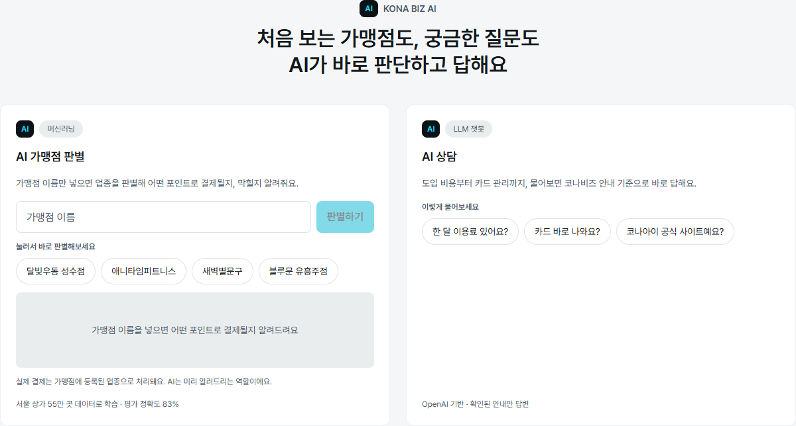
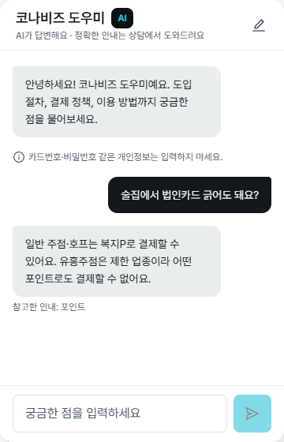
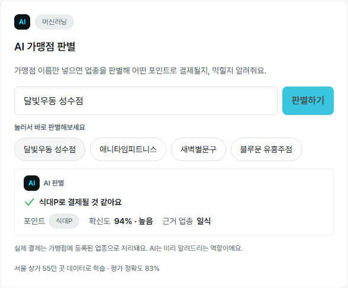
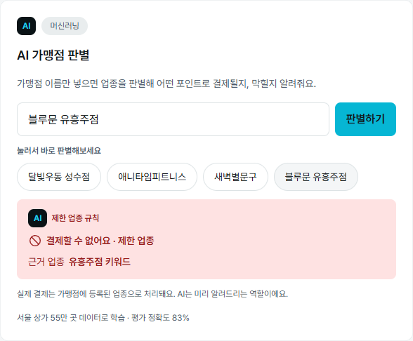
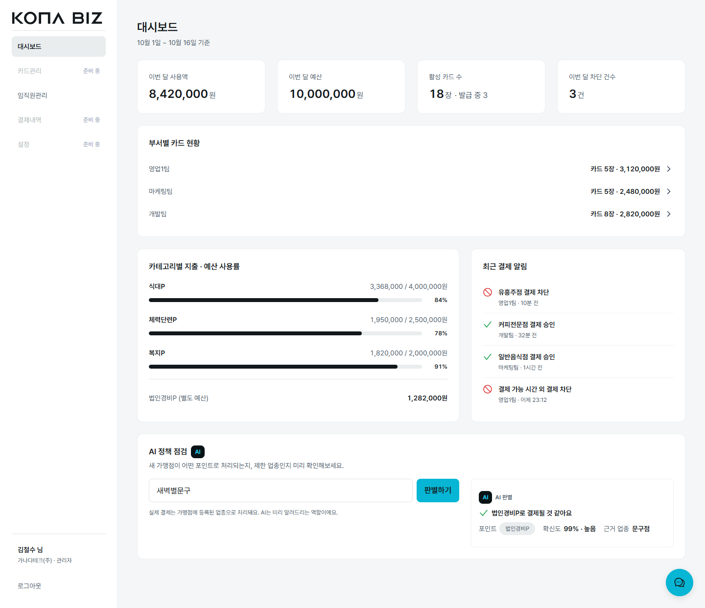
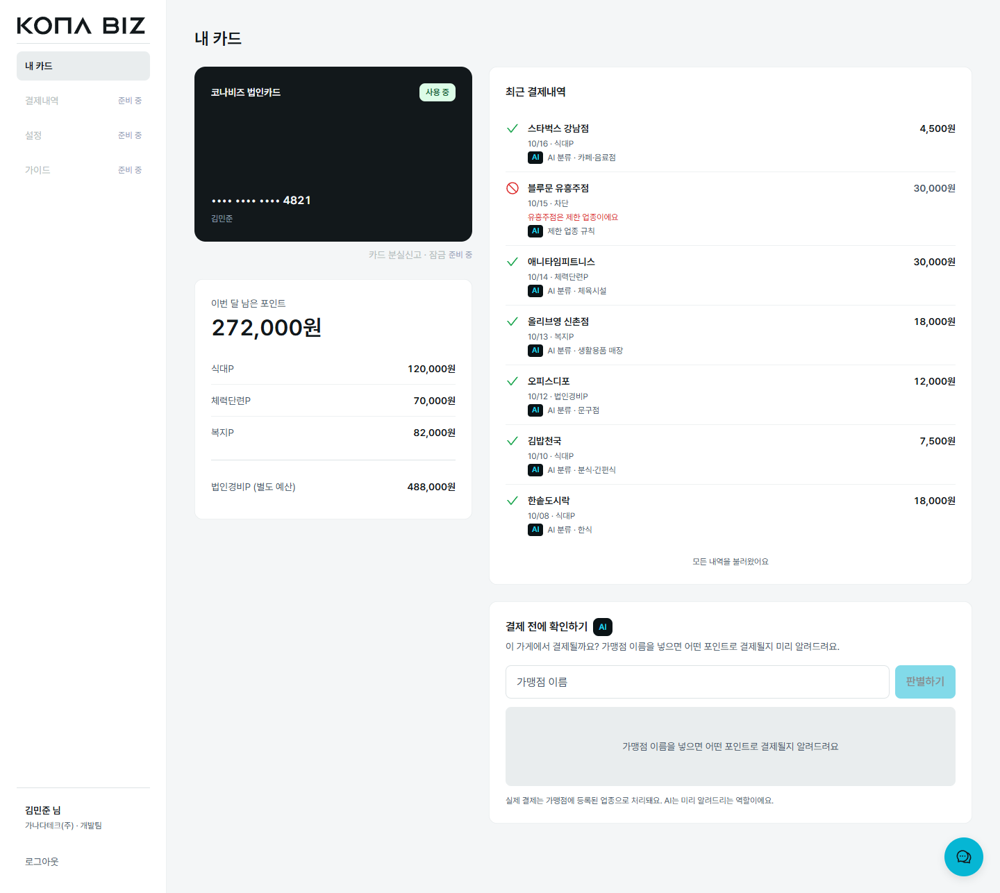
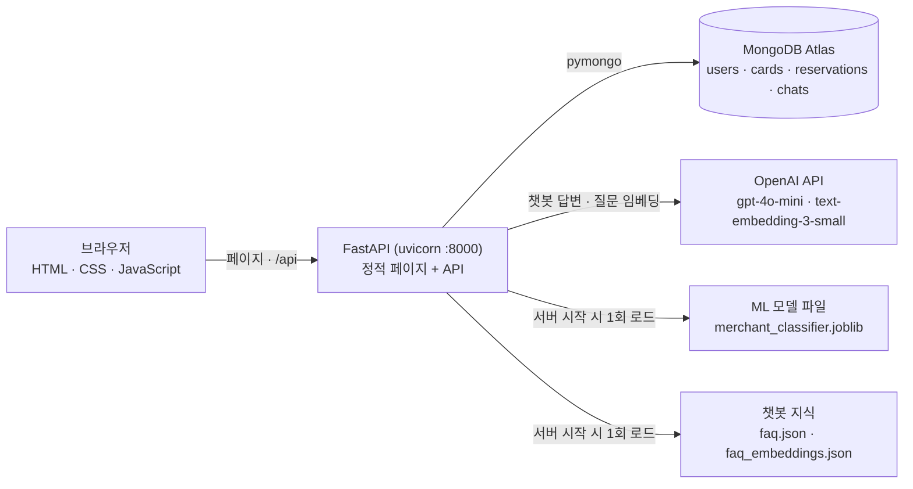

# 코나비즈 (KONA BIZ) — 업종·시간·한도를 통제하는 법인·복지카드 웹 서비스

랜딩 · 결제 시뮬레이터 · 상담 예약 · 관리자 대시보드 · 임직원 관리 · 임직원 마이페이지 · 가상 체험(Sandbox) · 챗봇까지 9개 화면을 FastAPI 하나로 제공하고, **AI 기능 2가지(머신러닝 가맹점 판별 · RAG 챗봇)** 를 붙인 프로젝트입니다.

> 이 사이트는 학습 목적의 비공식 컨셉이며, 코나아이(주)의 실제 코나비즈 서비스와 무관합니다.

## 대표 화면

| 랜딩 AI 섹션 | 챗봇 답변 + 참고한 안내 |
|---|---|
|  |  |
| **판별 결과 — 식대P · 확신도 높음** | **판별 결과 — 결제 불가(제한 업종 규칙)** |
|  |  |
| **관리자 대시보드 (AI 정책 점검)** | **임직원 마이페이지 (결제내역 AI 분류)** |
|  |  |

## AI 기능 2가지

| | ① ML 가맹점 판별 | ② RAG 챗봇 |
|---|---|---|
| **무엇을 하나** | 상호명만 보고 어떤 포인트(식대P·체력단련P·복지P·법인경비P)로 결제될지, 제한 업종인지 미리 알려줌 | 도입 비용·카드·포인트 정책 질문에 승인된 안내만 근거로 답하고, 근거로 쓴 안내의 카테고리를 표시 |
| **어디서 보나** | 랜딩 AI 카드 · 임직원 마이페이지 "결제 전에 확인하기" · 관리자 대시보드 "AI 정책 점검" · 결제내역 행의 "AI 분류" | 모든 화면 오른쪽 아래 챗봇 버튼 (랜딩 "이렇게 물어보세요" 칩) |
| **방법** | 글자 1~3-gram TF-IDF + 로지스틱 회귀 (scikit-learn). 업종 90개를 예측해 포인트 분류로 합산 → 근거 업종을 함께 보여줌 | 질문 임베딩(`text-embedding-3-small`) + 키워드 일치로 지식 상위 5개만 프롬프트에 넣고 `gpt-4o-mini`가 답함. 빠른 답변 버튼 4개는 OpenAI 없이 규칙 답변 |
| **핵심 숫자** | 서울 상가 554,092곳 → 고유 상호명 434,387개 학습 · **평가 정확도 0.834 · macro F1 0.647** (브랜드 누수를 막은 그룹 분할) | 지식 **55개** · 검색 기준값 **0.40** (질문 39개 시험: 관련 **25/25** 통과 · 무관 **0/10** 통과) |
| **안전장치** | 결제 불가 **확정은 키워드 규칙만**. 모델이 제한 업종이라 해도 확신도 0.9 이상이면 "주의", 그 밖은 "확실하지 않음"으로만 표시 | 지식에 없는 내용은 지어내지 않고 상담 안내. OpenAI 실패 시 대체 답변, 개인정보 형태는 가려서 보냄, 사용량 제한 |

## 과제 요구사항 대응

| 요구사항 | 구현 | 위치 |
|---|---|---|
| 메인페이지 로그인 | 랜딩 상단 [로그인] 모달 → `POST /api/auth/login` → JWT(HttpOnly 쿠키), 역할(관리자·임직원)별 화면으로 이동, 화면 보호 | `index.html` · `js/landing.js` · `backend/app/auth.py` · `routers/auth.py` |
| 회원가입 | **기획상 제외** — B2B 법인카드라 계정은 회사 관리자가 임직원을 초대해 발급(임시 비밀번호). 개인이 스스로 가입하는 흐름이 없음 | `admin-members.html` · `routers/members.py` |
| DB (MongoDB) | MongoDB Atlas + pymongo. `users` · `cards` · `reservations` · `chats` 4개 컬렉션, seed 스크립트 | `backend/app/db.py` · `backend/scripts/seed.py` |
| FastAPI & OpenAI API | FastAPI 한 서버가 정적 페이지와 `/api` 제공. OpenAI 공식 SDK로 Chat Completions(Structured Outputs) · Embeddings 호출 | `backend/app/main.py` · `routers/` · `routers/chat.py` · `app/rag.py` |
| LLM 자연어 처리 | 직접 입력한 질문을 LLM이 이해하고, 검색한 승인 지식 5개만 근거로 자연어 답변 | `routers/chat.py` · `app/chat_rules.py` · `app/knowledge/faq.json` |
| AI 서비스 2종 | ① ML 가맹점 판별 ② RAG 챗봇 (위 표) | `backend/ml/` · `app/ml_rules.py` · `routers/ml.py` · `js/classifier.js` / `js/chatbot.js` |
| Python 3.12 | Python 3.12.9 | `backend/.venv` |
| requirements.txt | 서버 실행 패키지 버전 고정 (개발·노트북용은 `requirements-dev.txt`) | `backend/requirements.txt` |
| GitHub | 이 저장소 (README 포함) | https://github.com/yxxjihyexn/konabiz |

## 데모 계정과 3분 체험

| 역할 | 이메일 | 비밀번호 |
|---|---|---|
| 관리자 (김철수) | admin@ganada.co.kr | kona-demo-1234 |
| 임직원 (김민준) | employee@ganada.co.kr | kona-demo-1234 |

1. **랜딩** http://localhost:8000 → AI 섹션의 예시 칩 4개를 누름: 달빛우동 성수점(식대P) · 애니타임피트니스(체력단련P) · 새벽별문구(법인경비P) · 블루문 유흥주점(결제 불가). 아무 가게 이름이나 직접 넣어봐도 됨 (예: "스타벅스" → 확신도 낮음 안내)
2. **챗봇** 오른쪽 아래 버튼 → "술집에서 법인카드 긁어도 돼요?" → 답변 아래 "참고한 안내: 포인트"
3. **임직원** [로그인] → employee 계정 → 결제내역마다 "AI 분류 · 카페·음료점", 아래 "결제 전에 확인하기"에 가게 이름 → 예상 포인트와 그 포인트의 남은 금액
4. **관리자** 로그아웃 → admin 계정 → 대시보드 맨 아래 "AI 정책 점검", 임직원관리에서 초대 → 임시 비밀번호로 새 직원 로그인
5. 로그인 없이: http://localhost:8000/sandbox.html (관리자·임직원 화면 미리보기, 판별기·챗봇은 실제로 동작)

시연이 끝나면 `python -m scripts.seed`로 데이터를 처음 상태로 되돌립니다.

## 시스템 구조



## 기술 스택

| 영역 | 사용 |
|---|---|
| 프론트엔드 | HTML · CSS · JavaScript(프레임워크 없음), Pretendard 폰트 |
| 백엔드 | Python 3.12 · FastAPI 0.146 · uvicorn · Pydantic |
| DB | MongoDB Atlas · pymongo 4.19 |
| 인증 | JWT(PyJWT, HttpOnly 쿠키) · Argon2 비밀번호 해시(pwdlib) |
| LLM | OpenAI SDK 3.35 · `gpt-4o-mini`(Structured Outputs) · `text-embedding-3-small` |
| ML | scikit-learn 1.9.1 · numpy · scipy · joblib (학습: pandas · matplotlib · Jupyter) |
| 테스트 | unittest · mongomock (DB·OpenAI에 붙지 않음) |

## 실행 방법

Python 3.12 기준, `backend` 폴더에서 실행합니다 (Windows PowerShell).

```powershell
cd backend
python -m venv .venv
.venv\Scripts\activate
pip install -r requirements.txt
copy .env.example .env        # 아래 값을 채움
python -m scripts.seed        # 데모 데이터 (MongoDB 연결 필요)
uvicorn app.main:app --reload --port 8000
```

- 접속: http://localhost:8000/ (상태 확인: http://localhost:8000/api/health → `{"status":"ok","db":"ok"}`)
- `.env`에 채울 항목 (값은 `backend/.env`에만 적고 커밋하지 않음 — `.gitignore`에 있음)

| 변수 | 내용 |
|---|---|
| `MONGODB_URI` | MongoDB Atlas 접속 주소 (Connect → Drivers의 `mongodb+srv://…`). 비밀번호가 들어 있으니 다른 곳에 붙여 넣지 않기. Atlas Network Access에 지금 PC의 IP 허용 필요 |
| `MONGODB_DB` | `konabiz` |
| `JWT_SECRET` | 긴 임의 문자열 — `python -c "import secrets; print(secrets.token_urlsafe(48))"` |
| `JWT_EXPIRE_MINUTES` | 로그인 유지 시간(분) |
| `COOKIE_SECURE` | 로컬(http)은 `false`, 배포(https)는 `true` |
| `OPENAI_API_KEY` | 챗봇용. 비어 있으면 챗봇은 대체 답변으로 동작 |
| `OPENAI_MODEL` | 기본 `gpt-4o-mini` |

- 로그인·API는 8000 서버에서만 동작합니다 (5500 같은 정적 서버로 열면 API가 없음).
- 외장하드의 드라이브 문자가 바뀌면 `.venv`가 동작하지 않으니 `.venv`를 지우고 다시 만드세요.
- 가맹점 판별 모델 파일(`backend/ml/models/merchant_classifier.joblib`, 16.9MB)은 저장소에 포함되어 있어 따로 학습하지 않아도 됩니다.

### 발표용 — 같은 네트워크의 다른 PC에서 접속

1. (처음 한 번) Windows 방화벽에서 TCP 8000 인바운드 허용 — 관리자 PowerShell:
   `New-NetFirewallRule -DisplayName "KonaBiz 8000" -Direction Inbound -Protocol TCP -LocalPort 8000 -Action Allow -Profile Private,Public`
2. 발표 장소 네트워크에서 MongoDB Atlas **Network Access**에 지금 공인 IP 추가 (장소가 바뀌면 공인 IP도 바뀜 → 로그인·예약이 DB 오류로 실패)
3. `backend\run_lan.bat` 실행 (탐색기에서 더블클릭) — 가상환경을 켜고, 접속 주소(`http://192.168.x.x:8000`)를 출력한 뒤 서버를 띄움
4. 다른 PC 브라우저에서 출력된 주소로 접속. 끄기는 창에서 Ctrl+C
5. 서버 창은 빠른 편집(QuickEdit)을 꺼서 띄우므로 창을 클릭해도 멈추지 않음. 그래도 응답이 멈추면 그 창에서 Esc

직접 실행하려면 (`backend` 폴더, 가상환경 켠 상태):

```powershell
uvicorn app.main:app --host 0.0.0.0 --port 8000
```

- `--host 0.0.0.0`이 없으면 이 PC(localhost)에서만 열림. 발표 때는 `--reload`를 빼서 파일 저장으로 서버가 다시 시작되지 않게 함
- 주소·링크·API 호출은 모두 상대 경로라 IP로 접속해도 그대로 동작. http라서 `COOKIE_SECURE=false` 유지
- 인터넷 연결 필요: DB(Atlas)·챗봇 직접 입력(OpenAI)·글꼴(Pretendard CDN). 글꼴만 실패하면 기본 글꼴로 보임

---

## 기술 상세

### 인증 · 화면 보호

- 비밀번호는 Argon2 해시(`pwdlib`)로만 저장. 로그인하면 JWT(유효 8시간, 내용은 user_id·role)를 HttpOnly · SameSite=Lax 쿠키로 줌. 배포(https)에서는 `COOKIE_SECURE=true`
- 이메일은 앞뒤 공백을 빼고 소문자로 비교. 모달에서 고른 탭과 상관없이 실제 역할의 화면으로 이동
- seed를 실행하면 데모 계정 2개에만 비밀번호가 들어감. 나머지 임직원 23명은 비밀번호가 없어 로그인되지 않음 (새로 초대하거나, 초대됨 상태면 임시 비밀번호 재발급). 비밀번호 찾기는 없음
- 틀린 이메일·비밀번호는 같은 문구로 안내하고, 정지·회수된 계정은 비밀번호가 맞을 때만 이용 중지 안내. 초대됨 상태의 임직원은 첫 로그인에 사용 중으로 바뀌고 카드도 발급 중 → 사용 중
- 페이지 보호: `admin.html`·`admin-members.html`은 관리자, `employee.html`은 임직원만. 로그인하지 않았으면 `index.html?login=1`(로그인 모달), 만료됐으면 만료 안내, 다른 역할이면 자기 화면으로. `sandbox.html`과 `?sandbox=1`이 붙은 `admin.html`·`employee.html`은 로그인 없이 열림
- 다른 라우터에서는 `app.auth`의 `require_login` · `require_admin` 의존성을 씀

### API 목록

| API | 로그인 | 설명 |
|---|---|---|
| `GET /api/health` | — | 서버·DB 상태 |
| `POST /api/auth/login` · `/logout` · `GET /api/auth/me` | — | 로그인 · 로그아웃 · 현재 사용자 |
| `GET /api/reservations/slots?from=&to=` | — | 기간(KST, 31일 이내) 안의 확정 예약 시각만 `{"closed": [...]}` |
| `POST /api/reservations` | — | 상담 예약 저장 → 201 `{id, preferred_at, consultation_type}` |
| `GET /api/members?dept=&status=&q=` | 관리자 | 자기 회사 임직원 목록 (초대일 최신순) |
| `POST /api/members` | 관리자 | 초대 `{name, email, dept}` → 201 `{member, temp_password}` |
| `POST /api/members/{id}/temp-password` | 관리자 | 임시 비밀번호 재발급 (초대됨만) |
| `POST /api/members/{id}/suspend` · `/resume` · `/revoke` | 관리자 | 정지 · 정지 해제 · 회수 |
| `GET /api/dashboard/summary` | 관리자 | 인원·카드 상태 숫자 `{employees, cards, departments}` |
| `GET /api/me/card` | 임직원 | 본인 카드 `{last4, status, holder, points, summary, transactions: [{paid_at, merchant, pocket, amount, status, blocked_reason, ai}]}` |
| `POST /api/chat` | — | `{message, quick_reply_id?, conversation_id, anon_id?}` → `{text, cta, sources?}` |
| `POST /api/ml/classify` | — | `{name}` → `{category, confidence, industry, source, level}` |

API 문서(Swagger): http://localhost:8000/api/docs

### 상담 예약

- 로그인 없이 씀 (예약자는 아직 계정이 없는 잠재 고객). `reservations`에 저장하고 브라우저 `kona.reservation`(Sandbox 상단 바 표시용)에도 남김
- **예약 가능 시간** — `backend/app/reservation_rules.py`와 `js/landing.js`가 같은 규칙: 오늘(KST)이 속한 주의 월요일부터 2주, 월~금, 10·11·14·15·16·17시. 지난 시간은 예약 불가(화면도 마감 칸과 같은 Disabled), 이번 주 남은 칸이 없으면 다음 주를 먼저 보여줌. KST로 계산하고 DB에는 UTC로 저장
- 서버에서 프론트와 같은 규칙으로 다시 검사 (회사명·담당자명 필수, 인원·카드 수 1~1,000,000, 휴대폰 형식, 이메일은 입력했을 때만, 상담 방식 `phone` | `inperson`(대면이면 주소 필수), 유입 경로 `hero`·`closing-cta`·`chatbot`·`simulator`·`landing`, 선택 조건 시간 0~24·한도 0~100,000·업종 7종). 실패 422 `{"detail": "입력값을 확인해주세요.", "errors": {항목: 문구}}` — 입력값은 돌려주지 않음
- 이미 확정된 시간 409 — 먼저 조회하지 않고 DB 고유 인덱스(`preferred_at`, `status: "confirmed"`일 때만)로 판단해서 동시에 들어와도 하나만 저장
- seed의 예약 3건은 seed 실행일 다음 평일들(첫째 날 11:00·15:00, 둘째 날 10:00)로 들어가 언제 시연해도 마감 칸이 보임. `?sandbox=1`에서는 예약 API를 부르지 않음

### 임직원 관리

- 관리자는 자기 회사 임직원만 보고 바꿈. 다른 회사 직원·관리자 계정·없는 id는 404, 임직원 계정은 403
- **상태 전이** (`backend/app/member_rules.py`, 회원 상태를 바꾸면 카드 상태도 같이)

| 지금 | 할 수 있는 것 | 결과 |
|---|---|---|
| 초대됨 (카드 발급 중) | 임시 비밀번호 재발급 · 회수 | 상태 유지(이전 임시 비밀번호 무효) · 회수됨 |
| 사용 중 | 정지 · 회수 | 정지 / 카드 정지 · 회수됨 |
| 정지 | 정지 해제 · 회수 | 사용 중 · 회수됨 |
| 회수됨 | 없음 (되돌릴 수 없음) | — |

- 표에 없는 동작(다른 탭에서 이미 바뀐 경우 포함)은 409. 상태 확인과 변경을 조건부 업데이트 한 번으로 해서 동시에 눌러도 하나만 바뀜
- 초대 검사: 이름 필수, 이메일 형식(소문자 저장), 부서는 영업1팀·마케팅팀·개발팀 → 422. 이미 있는 이메일 409, 회수된 직원의 이메일은 다시 초대 불가
- 초대하면 `users`(초대됨, 임시 비밀번호의 Argon2 해시)와 `cards`(발급 중, 포인트 4종 시작 잔액)가 함께 생김
- **임시 비밀번호**: 12자, 헷갈리는 문자(0 O o 1 l I) 제외. 평문은 초대·재발급 응답에서 한 번만 돌려주고 DB·로그에 남기지 않음. 메일 발송은 없고 완료 창의 [로그인 정보 복사]로 직접 전달. 완료 창은 [확인]으로만 닫힘
- 대시보드 "활성 카드 수"는 사용 중만 세고 발급 중은 "18장 · 발급 중 3"처럼 따로. 사용액·예산·카테고리·결제 알림은 예시값. CSV 일괄 등록은 예시 화면(저장 안 함)

### 임직원 마이페이지

- 본인은 쿠키 토큰의 user_id로만 찾음 (주소·파라미터로 다른 사람 id를 받지 않음). 관리자 403, 비로그인 401
- `summary.remaining` = 식대·체력단련·복지 3종 합계. 법인경비P는 별도 예산이라 따로
- 거래는 최신순, `paid_at`은 KST ISO 문자열. 차단 거래는 잔액에서 빠지지 않음. 처음 5건, [더 보기]마다 10건
- `ai`: seed 때 판별 모델로 계산해 거래 문서에 저장한 값 (화면에서 실시간 호출하지 않음). 모델 없이 seed하면 `null`이고 그 줄이 빠짐. Sandbox는 `js/mock-data.js`에 같은 값
- 결제·충전·거래 생성 API는 없음 (거래는 seed 데이터만)

### ML 가맹점 판별

**데이터** — 공공데이터포털 15083033 소상공인시장진흥공단 상가(상권)정보 **서울 2026-06** (554,092행, UTF-8). `backend/ml/data/`에 두고 커밋하지 않음(`.gitignore`, 원본은 읽기만)

**변환표** — `backend/ml/category_map.py` (표: `category_map.csv`). 업종 소분류 247개 → 근거 업종 90개 → 코나비즈 5분류

| 분류 | 업종 (업소 수) |
|---|---|
| meal 식대P | 음식점·카페(주점 제외) · 학원(입시·예체능·외국어 등) · 서점 (162,363) |
| fitness 체력단련P | 스포츠 서비스(당구장 제외) · 요가/필라테스·태권도/무술·레크리에이션 학원 · 의원·병원 · 약국 (38,890) |
| expense 법인경비P | 호텔·모텔(펜션 제외) · 여행사 · 렌터카 · 주유소·가스충전소 · 문구 · 사무기기 · 복사 (13,022) |
| restricted 제한 | 일반 유흥 주점 · 무도 유흥 주점 (2,484) |
| welfare 복지P | 그 밖의 모든 업종 — 요리 주점·생맥주(일반 주점), 펜션, 당구장, 안마·사우나, 노래방, 전문·사업 서비스 포함 (337,333) |

**모델** — `backend/ml/train.ipynb` (EDA · 모델 비교 · 평가 · 틀린 사례 해석 · 데모), 공통 코드 `backend/app/ml_rules.py`(정규화 · 키워드 규칙 · 예측 · 화면 level)
- 상호명 정규화(소문자·법인 표기·괄호·공백·특수문자 제거) → 이름 단위로 합침(체인점 한 표, 다수 분류 60% 미만 이름 제외) → 434,387개
- 글자 1~3-gram TF-IDF(특징 5만) + 로지스틱 회귀. 근거 업종 90개를 예측하고 확률을 분류별로 더해 확신도로 씀
- 샘플 가중치 = `log(1+업소 수)`(체인 가중치) × 분류 균형 (welfare : restricted = 227 : 1)
- 평가는 **그룹 분할**(정규화 이름 앞 3글자 — 같은 브랜드가 학습·평가에 나뉘지 않게) 80/20
- 저장: `backend/ml/models/merchant_classifier.joblib` (16.9MB) + `model_meta.json`(scikit-learn 1.9.1 등 버전·성능). 서버는 시작 시 한 번만 불러옴(약 0.6초). 파일이 없으면 서버는 켜지고 이 API만 503

**평가** (평가 86,878개, 모델만 — 키워드 규칙 제외)

| 모델 | 정확도 | macro F1 |
|---|---|---|
| **업종 합산 + 로지스틱 회귀 (사용)** | **0.834** | **0.647** |
| 5분류 직접 + 로지스틱 회귀 | 0.820 | 0.631 |
| 업종 합산 + ComplementNB | 0.697 | 0.523 |
| welfare 6만 개만 추출 | 0.816 | 0.627 |
| (참고) 무작위 분할 — 브랜드 누수 | 0.841 | 0.652 |

| 분류 | precision | recall | F1 |
|---|---|---|---|
| meal | 0.799 | 0.808 | 0.804 |
| fitness | 0.880 | 0.922 | 0.901 |
| welfare | 0.903 | 0.843 | 0.872 |
| expense | 0.368 | 0.683 | 0.479 |
| restricted | 0.106 | 0.567 | 0.178 |

- 확신도 0.6 이상이 73.4%, 그 안 정확도 0.915 (미만 0.611)
- 키워드 규칙만: precision 0.667 · recall 0.129 (업태가 이름에 드러난 경우만 확실히 막는 용도)

**화면 정책** (level — 서버가 `app/ml_rules.py`의 기준값으로 계산, 화면은 level만 보고 그림)

| level | 조건 | 화면 |
|---|---|---|
| `block` | 키워드 규칙(유흥주점·단란주점·룸살롱·룸싸롱·가라오케·노래빠·나이트클럽, 공백 무시) | "결제할 수 없어요 · 제한 업종" |
| `warn` | 모델 restricted, 확신도 ≥ 0.9 | "제한 업종일 수 있어요" — 차단으로 단정하지 않음 |
| `high` | 확신도 ≥ 0.6, 법인경비P만 ≥ 0.7 | "○○P로 결제될 것 같아요" + 확신도 + 근거 업종 |
| `low` | 그 밖 (restricted < 0.9 포함) | 예상은 보여주되 "이름만으로는 확실하지 않아요" |

- 모델 판정만으로 차단하지 않는 이유: 확신도 0.9 이상에서도 restricted precision 0.351(288건 중 101건) — 노래방·주점을 유흥주점으로 보는 경우가 많음
- 실제 결제는 가맹점에 등록된 업종으로 처리되고 AI는 미리 알려주는 역할이라 "결제될 것 같아요"로 표기. 화면 확신도는 최대 99%
- API: 로그인 없이, 빈 값·50자 초과 422, 같은 IP 1분 30회 → 429

**재학습** (`backend` 폴더, 원본 CSV를 `backend/ml/data/`에 둔 뒤)

```powershell
pip install -r requirements-dev.txt
python ml/category_map.py                                            # 변환표 CSV (규칙을 고쳤으면)
jupyter nbconvert --to notebook --execute --inplace ml/train.ipynb   # 약 45분 — 모델 5개 비교 + 최종 모델 저장
python -m scripts.seed                                               # 결제내역 ai 다시 계산
```

- 재학습하면 같이 고칠 곳: `js/mock-data.js`의 김민준 거래 `ai` 값(Sandbox), 랜딩 AI 카드의 "평가 정확도 83%", 이 README의 숫자. 그다음 서버 재시작
- 기준값(0.6 · 0.7 · 0.9)과 근거 업종 표시 이름(예: 비알코올 → 카페·음료점)은 `app/ml_rules.py` 한 곳

### RAG 챗봇

**구조**
- **빠른 답변 버튼**(lead-time · limits · pricing · booking) → `backend/app/chat_rules.py`의 정해진 답변. OpenAI를 부르지 않음
- **직접 입력한 질문** → 관련 승인 지식 5개만 시스템 프롬프트에 넣고 OpenAI가 답함. 지식에 없는 사실·관계없는 질문은 지어내지 않고 상담 안내 + [상담 예약하기]. 역할 변경·프롬프트 공개·지시 무시 요청은 따르지 않음
- **cta**: `booking`([상담 예약하기]) · `simulator`([무료로 체험하기]) · 없음
- OpenAI 실패·타임아웃·키 없음·형식 오류 → 대체 답변 "지금은 자세히 답변드리기 어려워요. 정확한 안내는 상담에서 도와드릴게요." + [상담 예약하기]. 로그에는 오류 종류만

**지식 파일** — `backend/app/knowledge/faq.json`, **55개** (`F1`~`F32` 승인 FAQ, `N1`~`N27` 기획서에서 뽑은 Q&A, 빈 번호 있음). `category`가 화면의 "참고한 안내"에 그대로 나옴

```json
{ "id": "F18", "category": "포인트", "question": "법인경비P는 어디에 쓰고 어떻게 차감돼요?",
  "answer": "법인경비P는 별도 예산이에요. 사무용품, 출장(항공·숙박), 거래처 접대에 쓰고, …", "source": "7단계 승인 FAQ" }
```

**검색 흐름** (`backend/app/rag.py`, 표준 라이브러리만 — 수십 개라 벡터 DB 없음)
1. 질문(개인정보 가림)을 `text-embedding-3-small`로 임베딩 (타임아웃 5초). 직전 질문이 있으면 "직전 + 이번 질문"도 함께 임베딩해 높은 점수를 씀 ("그건 얼마예요?" 같은 이어지는 질문)
2. 미리 계산한 지식 벡터(`faq_embeddings.json`)와 코사인 유사도 → 상위 5개. **키워드 일치**(지식에만 있는 3글자 이상 낱말)가 있으면 그 항목을 먼저 넣고 관련 있음으로 봄
3. 1위 유사도가 **0.40 미만이고 키워드 일치도 없으면** "관련 지식 없음"으로 호출 → 범위·상담 안내, `sources` 없음
4. 응답(Structured Outputs `{text, cta, used_ids}`)을 서버에서 다시 검사 — `used_ids` 중 프롬프트에 넣은 5개 안의 id만 `sources`로 → 화면 "참고한 안내: 포인트"
5. 임베딩 파일이 없거나 `faq.json`과 해시가 다르면, 또는 임베딩 API 실패면 검색 없이 지식 전체로 답함 (`sources` 표시 안 함)

**기준값 0.40을 고른 근거** — 질문 39개(관련 25 · 지식에 없는 코나비즈 질문 4 · 무관 10)의 1위 유사도

| | 결과 |
|---|---|
| 무관(날씨·주식·코딩·번역·농담·KTX·지시 무시 등) | 0.202 ~ **0.337** |
| 관련이고 검색이 맞은 질문 | 0.432 ~ 0.685 |
| 0.40 + 키워드로 통과 | 무관 **0/10** · 관련 **25/25** |

- 0.40은 무관 최댓값과 관련 최솟값 사이의 가운데. 짧은 질문("사원증형이 뭐예요?" 0.356)은 키워드 일치로 보완

**OpenAI 호출** — `gpt-4o-mini`(`.env`의 `OPENAI_MODEL`), 답변 상한 300토큰, temperature 0.2, 타임아웃 15초. 같은 대화의 최근 6개 메시지만 맥락으로. 사용자 이름·이메일은 보내지 않고 질문 안의 이메일·전화번호·카드번호 형태는 가림. API 키는 서버에서만 씀

**입력 검사 · 사용량 제한 · 저장**
- 빈 값 422, 500자 초과 422. 같은 uid 1분 10회 · 같은 IP 1분 30회 → 429 (서버 메모리 기준)
- `chats`에 `{uid, conversation_id}`로 질문·답변 저장 (로그인이면 `users._id`, 아니면 브라우저 임시 ID). 로그인 성공 → 새 대화, 로그아웃 → 임시 ID 삭제. DB가 없으면 답변만 함
- 로그인 사용자의 포인트·거래를 챗봇이 조회하는 기능은 없음

**지식을 고친 뒤**

```powershell
python -m scripts.build_knowledge   # faq.json → faq_embeddings.json (OpenAI 임베딩 1회)
```

다시 만든 뒤 서버를 재시작합니다. 문구는 사이트 화면·기획서와 같이 고치고, id는 바꾸지 않습니다(대화 기록·테스트에서 씀).

### 테스트

DB·OpenAI에 붙지 않습니다 (메모리 DB `mongomock`, OpenAI는 가짜 응답). **87개 통과**

```powershell
cd backend
pip install -r requirements-dev.txt
python -m unittest discover -s tests -t . -v
```

| 파일 | 개수 | 내용 |
|---|---|---|
| `test_chat.py` | 38 | 빠른 답변(OpenAI 0회), RAG(상위 5개 · 기준값 · 키워드 · used_ids 검증 · 이어지는 질문 · 검색 실패 시 전체), 지식 파일 형식·해시, 개인정보 가림, 대체 답변, 422·429, 대화 저장·남의 대화 접근 불가 |
| `test_ml.py` | 17 | level 기준(규칙만 block · 0.6 · 법인경비 0.7 · 0.9), 키워드 규칙, 빈 값·51자 422, 모델 없음·예측 오류 503, 근거 업종 표시 이름, IP 429, 실제 모델 응답 형식 · 랜딩 예시 칩 4개 |
| `test_reservations.py` | 12 | 예약 가능 시간 규칙(주말 · 연말 · KST 날짜 · 지난 시간), 입력 검사 · 시간 오류, 대면 주소, 유입 경로, 법인경비P 업종에 거래처 접대 포함 |
| `test_members.py` | 11 | 초대(사용자 · 카드 생성) · 입력 검사 · 중복 이메일, 임시 비밀번호 1회 노출 · 재발급 후 로그인, 상태 전이 전체, 정지 · 회수 후 로그인 차단, 다른 회사 404 · 임직원 403, 목록 필터, 대시보드 숫자 |
| `test_me.py` | 9 | 본인 카드만, 잔액 · 거래 7건, 합계에서 법인경비P 제외, 최신순 · KST, 거래 AI 분류, 민감 정보 없음, 403 · 401 · 404 |

---

## 폴더 구조

```
konabiz/
├─ index.html                 랜딩 (시뮬레이터 · 상담 예약 · 로그인 모달 · AI 섹션)
├─ admin.html                 관리자 대시보드
├─ admin-members.html         임직원 관리
├─ employee.html              임직원 마이페이지
├─ sandbox.html               가상 체험 (관리자·임직원 화면을 iframe으로)
├─ style.css · landing.css · app.css · sandbox.css
├─ js/                        common · landing · app · admin · admin-members · employee · sandbox · sandbox-mode
│                             mock-data(예시 데이터) · chatbot · chat-reply · classifier(판별기)
├─ assets/                    아이콘 · 로고 (SVG)
├─ docs/images/               README 캡처
└─ backend/
   ├─ app/
   │  ├─ main.py              FastAPI 앱 (/api 라우터 + 정적 파일)
   │  ├─ config.py · db.py · auth.py
   │  ├─ reservation_rules.py · member_rules.py · chat_rules.py · ml_rules.py · rag.py
   │  ├─ knowledge/           faq.json · faq_embeddings.json
   │  └─ routers/             health · auth · reservations · members · dashboard · me · chat · ml
   ├─ ml/                     category_map.py/.csv · prepare.py · train.ipynb · models/ (data/는 커밋 제외)
   ├─ scripts/                seed.py · seed_data.py · build_knowledge.py
   ├─ tests/                  unittest 5개 파일
   ├─ requirements.txt · requirements-dev.txt
   └─ .env.example
```

## 데이터 출처 · 라이선스

- 소상공인시장진흥공단 상가(상권)정보 — 공공데이터포털 **15083033**, 이용허락범위 제한 없음. 원본 CSV는 용량(약 288MB) 때문에 저장소에 넣지 않았고, 학습한 모델 파일과 변환표만 포함
- 화면의 회사·임직원·결제 데이터는 모두 예시(가상)입니다

## 한계와 향후 과제

- **가맹점 판별은 이름만 봄** — 이름에 업종 단어가 있어도 실제 업종이 다르면 틀리고(달커피숖 → 실제 주점), 업종 단서가 없는 브랜드형 이름은 확신도가 낮음. 유흥주점 이름 대부분은 단서가 없어 모델로 차단하지 않고 키워드 규칙만 확정에 씀. expense는 많이 예측하는 편(precision 0.37). 공공데이터 등록 업종 오류도 평가 점수를 낮춤. 서울 2026-06 데이터만 사용
- **향후**: 업종 코드·주소 등 가맹점 정보를 함께 쓰는 모델, 전국 데이터, 관리자가 판별 결과를 정정하면 학습 데이터로 쌓는 흐름
- **챗봇**: 로그인 사용자의 잔액·거래를 조회해 답하는 기능은 없음 (향후: 본인 데이터 조회 도구). 사용량 제한은 서버 메모리 기준이라 재시작하면 초기화
- **서비스 범위**: 실제 결제·충전·메일 발송 없음, 대시보드 사용액·예산·결제 알림은 예시값, CSV 일괄 등록은 예시 화면, 카드관리·결제내역·설정 메뉴는 준비 중
